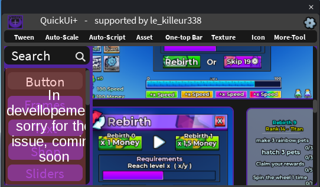
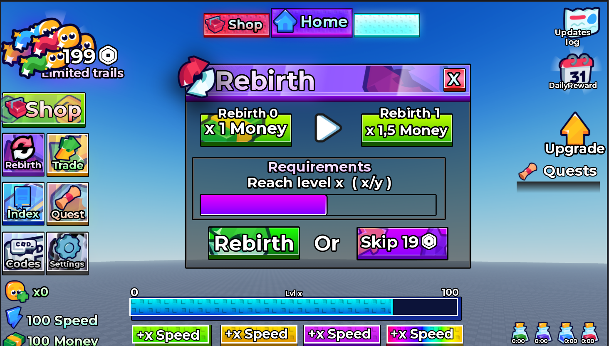

## 🧩 Asset

A library of ready-to-use UI elements you can add to your game in one click.

### How to use

1. Open the **Asset** tab.
2. Use the **Search** bar or the categories on the left (Button, Frames, Shop, Sliders...).
3. Click an asset.

The asset is added to **StarterGui** inside a new `ScreenGui` and selected, so you can edit it right away. You can undo it with `Ctrl + Z`.

Hover an asset to see the name of its creator.

> This tab is **in development**: more assets and categories are coming soon.

### Example

A "Rebirth" screen built with QuickUi+ assets:

