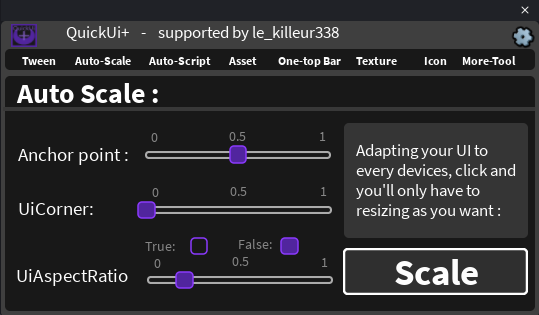

## 📐 Auto-Scale

Makes your UI adapt to every device, and quickly sets a few common properties.

### Scale button

1. Place and resize your element as you want in Studio (in pixels, with the mouse).
2. Select it (you can select several elements).
3. Click **Scale**.

The element's **Size** is converted to **Scale** values (relative to its parent), rounded to 3 decimals. After that, the element follows the size of its parent on every screen.

> The element must be a `GuiObject` with a parent that has a size, otherwise you get the error *No valid UIObject selected!*

### Sliders

The sliders apply **live** to every selected `GuiObject`:

| Slider | What it changes |
|---|---|
| **Anchor point** | Sets the `AnchorPoint` (X and Y at the same time) from 0 to 1. Default: `0.5` (center). |
| **UiCorner** | Adds a `UICorner` if needed and changes its radius, from 0 to 50 pixels. |
| **UiAspectRatio** | Adds a `UIAspectRatioConstraint` and changes its ratio (from 0.25 to 4). |

For **UiAspectRatio**, use the **True / False** toggle:

- **True**: the slider edits the aspect ratio.
- **False**: the `UIAspectRatioConstraint` is removed from the selected elements.
