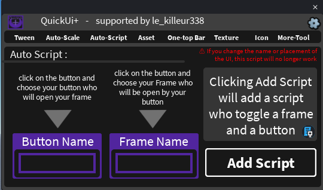

## 🔁 Auto-Script

Creates a script that opens and closes a frame when you click a button, without writing any code.

### How to use

1. Click the **Button Name** box, then select your **button** (a `TextButton` or `ImageButton`) in the Explorer. Its name appears in green.
2. Click the **Frame Name** box, then select the **frame** (any `GuiObject`) that the button must open. Its name appears in green.
3. Click **Add Script**.

A `LocalScript` named **ToggleScript** is added inside the button. When the button is clicked, the frame's `Visible` property is toggled.

The script has a **"PUT YOUR VARIABLES HERE"** area where you can add your own code.

### Good to know

- The script finds the frame **by its name** inside the same `ScreenGui`. If you rename the frame or move it to another ScreenGui, the script will no longer work (the plugin shows a warning about it).
- If you forget to select a button or a frame, an error message tells you what is missing.
- After the script is added, the two boxes are cleared so you can create another one.
