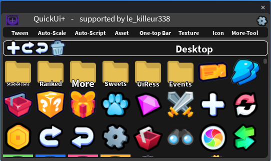

## 🖼️ Icon

A library of icons that you can organize in folders, and add to your UI in one click.

### Add an icon to your UI

1. Select a UI element (a `Frame`, a `ScreenGui`...).
2. Open the **Icon** tab and click an icon.

The icon is added as an `ImageLabel` inside the selected element, centered, and selected so you can move it. If nothing valid is selected, an error message tells you.

### Folders

The icons are organized in folders, starting from **Desktop**: *StudioIcons*, *Ranked*, *More*, *Sweets*, *UiRess*, *Events*...

Click a folder to open it. The toolbar above the grid contains:

| Button | Description |
|---|---|
| **+** | Create a new **Folder** or a new **Image** (from a Roblox image ID). |
| **Back / Forward arrows** | Go back to the previous folder, or forward again. |
| **Trash** | Delete icons. |

You can also **hold and drag** an item to move it into a folder, and rename a folder. Your own folders and images are **saved** in the plugin, so you find them again later.
