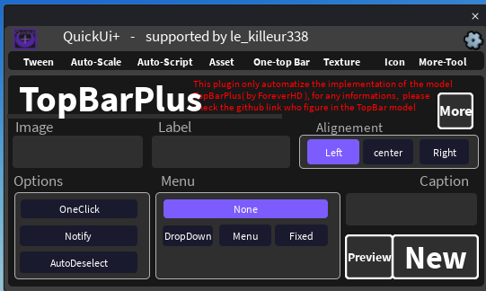

## 🔝 One-TopBar

Creates buttons in the Roblox top bar (next to the Roblox menu) without writing code.

> This tab only **automates the use of the TopBarPlus module by ForeverHD**. For more information about the module, see the TopBarPlus page linked in the TopBar module.

### Settings

| Setting | Description |
|---|---|
| **Image** | The image of the icon (a Roblox image ID). |
| **Label** | The text of the icon. |
| **Caption** | The small tooltip shown when you hover the icon. |
| **Alignment** | Where the icon is placed: **Left**, **center** or **Right**. |

### Options

| Option | Description |
|---|---|
| **OneClick** | The icon acts as a simple button instead of staying selected. |
| **Notify** | Enables the notification badge on the icon. |
| **AutoDeselect** | The icon is deselected automatically when you click elsewhere. |

### Menu

| Menu type | Description |
|---|---|
| **None** | No menu. |
| **DropDown** | A drop-down list under the icon. |
| **Menu** | A menu that opens from the icon, with a close button. |
| **Fixed** | A fixed menu displayed in the top bar. |

### Buttons

- **Preview** opens a preview window. It is only an approximation, **not the exact Roblox render**.
- **New** adds the TopBar to your game: the TopBarPlus `Icon` module is placed in **ReplicatedStorage** and a `LocalScript` with your settings is placed in **StarterPlayerScripts**. If you click **New** again, the previous version is replaced.
- **More** opens a window with more advanced functions.
