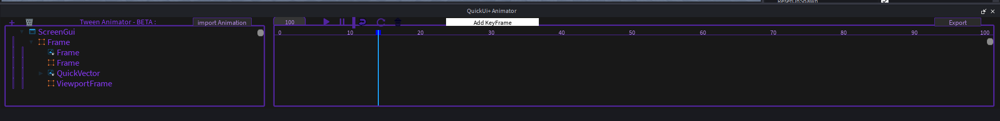

## 🎬 Animator (Beta)

A timeline to animate your UI directly in Studio, without writing code.

You can open it from the **Tween** tab with **Open Animator**. It opens in its own window.

### The window

| Area | Description |
|---|---|
| **Explorer** (left) | The ScreenGui you are animating and its elements. Select an element to animate it. |
| **Timeline** (right) | A ruler from **0 to 100** with a playhead (the blue line). |
| **Add KeyFrame** | Records the current state of the selected element at the playhead position. |
| **Play / Pause / Loop** | Preview your animation. |
| **import Animation** | Loads an animation you exported before. |
| **Export** | Exports the animation as code (see below). |

### Make an animation

1. Load your ScreenGui in the Explorer panel of the Animator.
2. Select an element, move the playhead and change its properties in Studio.
3. Click **Add KeyFrame**.
4. Move the playhead to another time, change the element again, and add another keyframe.
5. Press **Play** to preview.

Keyframes can be dragged on the timeline. Each keyframe has its own easing style (the default is *Linear*).

### Properties you can animate

- **Any GuiObject**: Position, Size, AnchorPoint, BackgroundColor3, BackgroundTransparency, BorderColor3, BorderSizePixel, Rotation, Visible, ZIndex
- **Text**: Text, TextColor3, TextTransparency, TextStrokeColor3, TextStrokeTransparency, TextSize, FontFace, TextXAlignment, TextYAlignment
- **Images**: Image, ImageColor3, ImageTransparency, ScaleType, SliceCenter, TileSize
- **UIStroke** and other UI objects (corner, gradient...) added to your elements

### Export

**Export** opens a window where you choose:

- an animation **name**,
- the export mode: **TweenService** or **RunService**,
- if the animation should **loop**,
- where to put the generated script (**parent**).

The animation is generated as a module script that you can require from your own scripts.

> The Animator is in **beta**: some properties or cases may not be supported yet.
