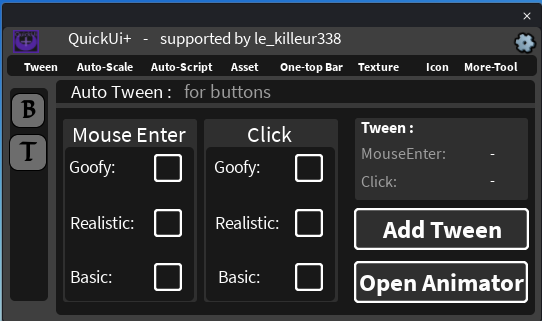

## 🔘 ButtonTween

Adds a hover and click animation to your buttons in one click.

### How to use

1. Select one or more **TextButton** / **ImageButton** in the Explorer.
2. Open the **Tween** tab, then the **B** tab (*Auto Tween : for buttons*).
3. In the **Mouse Enter** column, choose a style: **Goofy**, **Realistic** or **Basic**.
4. In the **Click** column, choose a style as well.
5. The **Tween** box on the right shows your two choices.
6. Click **Add Tween**.

A `LocalScript` is added inside each selected button. It is a normal script, so you can open it and change the values at the top (scale, rotation, duration...).

> Only TextButton and ImageButton are supported. You must choose a style for **both** Mouse Enter and Click.

### The 3 styles

| Style | Feeling |
|---|---|
| **Goofy** | Exaggerated: big scale, tilt and bouncy / elastic easing. |
| **Realistic** | Smoother and subtler, with color feedback (the button is darkened when pressed). |
| **Basic** | Simple scale up on hover and a quick scale pulse on click. |

Because you pick one style for Mouse Enter and one for Click, there are **9 combinations** (for example *Goofy hover + Realistic click*).

### Animator

**Open Animator** opens the [Animator](Animator.md), to build your own animations.
