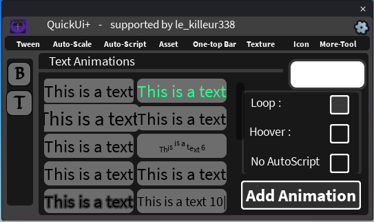

## 🔤 TextTween

Adds an animation to a text element in one click.

### How to use

1. Select **one** `TextLabel`, `TextButton` or `TextBox`.
2. Open the **Tween** tab, then the **T** tab (*Text Animations*).
3. Click an animation in the list. It is previewed live.
4. Choose a play mode (see below).
5. Click **Add Animation**.

A `LocalScript` is added inside the text element. Its play mode is stored in a `PlayMode` attribute.

### The 10 animations

| # | Animation | What it does |
|---|---|---|
| 1 | **Typewriter** | Types the text letter by letter, then erases it. |
| 2 | **Rainbow** | Cycles the text color through the whole spectrum. |
| 3 | **Pulse** | Gently scales the text up and down. |
| 4 | **Glitch** | Randomly swaps letters with symbols and shakes the text. |
| 5 | **Fade** | Fades the text out and back in. |
| 6 | **Wave** | Each letter moves up and down in a wave. |
| 7 | **Slide in** | The text slides in while fading in. |
| 8 | **Pop** | The text pops in with an elastic bounce. |
| 9 | **Stroke flicker** | Makes the text outline (`UIStroke`) flicker. |
| 10 | **Typewriter + cursor** | Typewriter with a blinking `\|` cursor. |

### Play modes

| Option | Description |
|---|---|
| **Loop** | The animation plays continuously. This is the default. |
| **Hover** | The animation plays when the mouse hovers the text. |
| **No AutoScript** | The script is added but does not start by itself. |
