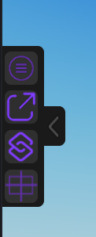

## 🧰 More Tools

Small tools that help you while you build your UI. They are available from the **More-Tool** tab and from the **side toolbar**.

### Side toolbar

A small collapsible toolbar sits on the left of the viewport. Click the arrow `<` to open or close it.

From top to bottom:

| Button | Tool |
|---|---|
| ☰ | [Preset](Preset.md) - copy a style from one element to others |
| ↗ | [Convert](Convert.md) - change the class of an element |
| S | [Shortcuts](Shortcuts.md) - turn the on-canvas helpers on or off |
| ▦ | [Precision tool](Zoom.md) - Zoom and Nudge |

Each tool opens in its own window:

### More-Tool tab

The **More-Tool** tab of the main window contains the other tools:

- [Screen > SurfaceGui](ScreenToSurfaceGui.md)

### On-canvas helpers

When you select a UI element, QuickUi+ can display small handles around it:

- [Rotate](Rotate.md) - drag to rotate the element
- [Center](Center.md) - click to center the element in its parent
- **QuickAction** - a floating panel of quick actions (see [Shortcuts](Shortcuts.md))
