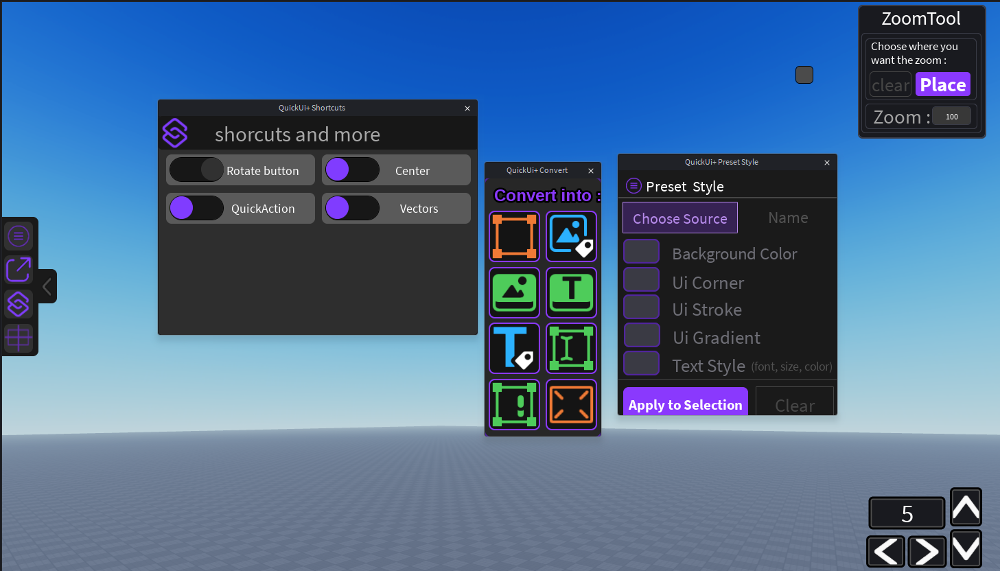

## 🎨 Preset

Copies the style of one element and applies it to other elements.

### How to use

1. Open **Preset** in the side toolbar (the ☰ button).
2. Click **Choose Source**, then select the element that has the style you want. Its name is displayed.
3. Check what you want to copy:
   - **Background Color**
   - **Ui Corner**
   - **Ui Stroke**
   - **Ui Gradient**
   - **Text Style** (font, size, color)
4. Select the elements to restyle.
5. Click **Apply to Selection**.

Options that the source element cannot provide (for example *Ui Stroke* if it has no `UIStroke`) are grayed out.

**Clear** removes the current source.
