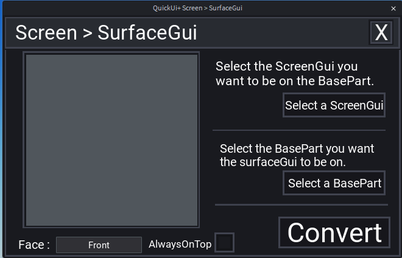

## 🧊 Screen > SurfaceGui

Puts an existing `ScreenGui` on a part in the world, as a `SurfaceGui`.

Open it from the **More-Tool** tab.

### How to use

1. Click **Select a ScreenGui**, then click the ScreenGui you want to use.
2. Click **Select a BasePart**, then click the part that will display it.
3. Choose the **Face** of the part (default: *Front*).
4. Check **AlwaysOnTop** if you want it (the UI is displayed above everything).
5. Click **Convert**.

A `SurfaceGui` with the same name is created inside the part, with a **copy** of everything that was inside the ScreenGui (the original ScreenGui is not removed). The preview on the left shows how it will look on the part.

You can undo it with `Ctrl + Z`.
