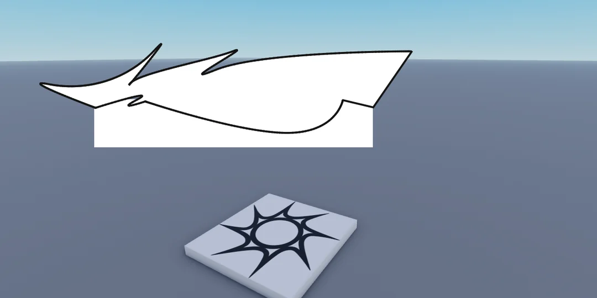
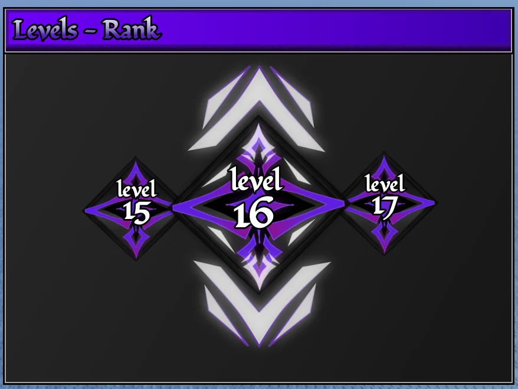
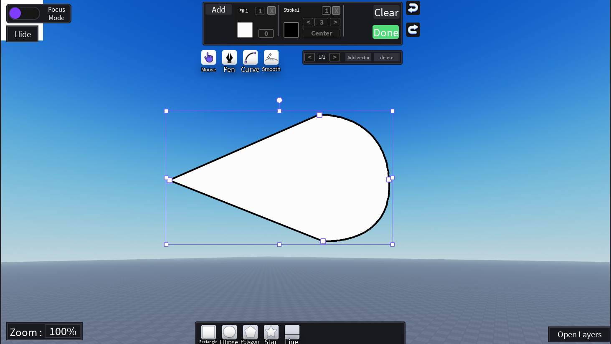
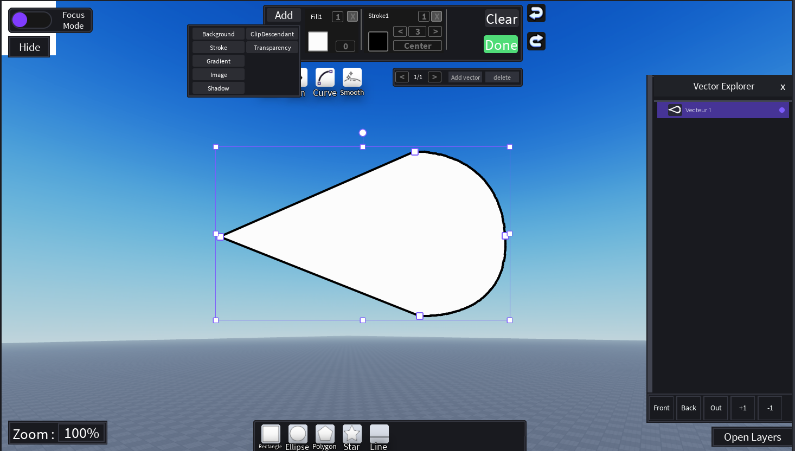

## QuickUi+ Vector Creator

## What is a vector, and what is Vector Creator used for?

In this context, a vector is a shape defined by points and paths. It lets you create simple or complex shapes such as curves, stars or logos. Unlike a regular image made of pixels, a vector path can be resized without losing its sharpness.

By default, Roblox Studio UI elements are mainly rectangular. `UIStroke`, `UICorner` and other components let you customize their appearance, but they don't let you freely create complex shapes. That's where **QuickUi+ Vector Creator** comes in.

Vector Creator is a tool integrated directly into Roblox Studio that lets you draw and customize vector shapes without using any external application.

---

## Setup

When you select a `Frame`, an **Add Vector** button appears at the top center of your screen.

The first time you click it, a short tutorial appears. Follow it to set up the tool correctly.

The tutorial explains how to enable **CreateAssetAsync Using Lua API** in Studio's **Beta Features**. Once it is enabled, restart Roblox Studio.

You're now ready to use Vector Creator.

---

## Basics

The interface is divided into 4 sections:

| Section | Position |
|---|---|
| **Main Panel** | Top center |
| **Layers** | Bottom right |
| **Shapes** | Bottom |
| **Utilities** | Left side |

### Main Panel

The Main Panel contains a vertical Explorer, the `Done`, `Clear` and `Add` buttons, 4 tools, and a panel to add, remove and navigate between vectors.

Clicking **Add** opens a menu with 7 parameters:

| Parameter | Description |
|---|---|
| **Background** | Customize the vector's background. |
| **Stroke** | Add an outline to the vector. |
| **Gradient** | Add a color gradient. |
| **Image** | Add an image. |
| **Shadow** | Add a shadow. |
| **ClipDescendants** | Clip child elements to their parent's bounds. |
| **Transparency** | Adjust transparency. |

Each parameter has its own properties, similar to those found in Roblox Studio (for example, `StrokeThickness`).

- You can add multiple Strokes, Gradients, Images, UIShadows and Transparency parameters, but only **one** Background and **one** ClipDescendants parameter.
- Parameters only apply to the currently selected vector.
- Each parameter, except ClipDescendants, has a TextBox to adjust its `ZIndex`.
- Gradient and Transparency also have a **LINK** button next to the `ZIndex` TextBox. It lets you link certain parameters together, such as a Gradient and a Stroke. Linking is not supported for every element yet.

**Clear** removes the current vector's contents. You can use `Undo` to undo your last action.

**Done** exports your creation as a single `ImageLabel` in Roblox Studio. You can select the exported `ImageLabel` to edit your creation again with Vector Creator.

#### Tools

| Tool | Description |
|---|---|
| **Move** | Move paths. |
| **Pen** | Draw paths by adding points. |
| **Curve** | Create or edit curves. |
| **Smooth** | Smooth paths and their points. |

You can also add or remove vectors and switch between them.

### Layers

The Layers panel is hidden by default. Click **Open Layers** to open it.

Here you can view all available vectors and rearrange them. The vector at the top of the list has the highest `ZIndex`.

You can also place vectors inside other vectors, which is useful for `ClipDescendants`, and toggle their visibility.

### Shapes

The Shapes section lets you add predefined shapes by clicking their icons.

Available shapes: **Rectangle**, **Polygon**, **Ellipse**, **Star** and **Line**.

> Hold **Shift** while creating a shape to keep its proportions.

### Utilities

| Utility | Description |
|---|---|
| **Focus Mode** | Display a background behind your vectors to make them easier to see. |
| **Hide** | Hide the Main Panel and the Shapes section. |
| **ZoomTextBox** | Display and adjust the zoom percentage. |

---

## Shortcuts

### Keyboard

| Key | Action |
|---|---|
| `P` | Activate Pen |
| `V` | Activate Edit |
| `R` | Activate Rectangle |
| `O` | Activate Ellipse |
| `L` | Activate Line |
| `Ctrl + Z` | Undo |
| `Ctrl + Shift + Z` | Redo |
| `Ctrl + Y` | Redo |
| `Ctrl + C` | Copy selected vector |
| `Ctrl + V` | Paste copied vector |
| `Ctrl + D` | Duplicate selected vector |
| `Arrow Keys` | Move selected path |
| `Shift + Arrow Keys` | Move in larger increments |
| `E` | Reset zoom and view position |
| `Enter` | Exit edit mode |
| `Esc` | Exit edit mode |
| `Mouse Wheel Up` | Zoom in |
| `Mouse Wheel Down` | Zoom out |

### Path editing

| Action | Result |
|---|---|
| `Left-click a node` | Delete the node |
| `Drag a node` | Move the point |
| `Drag a handle` | Edit the Bézier curve |
| `Shift + Drag` | Constrain angles to 45° increments |
| `Alt + Drag a handle` | Disable node smoothing while dragging |
| `Alt` | Display measurements between vectors |
